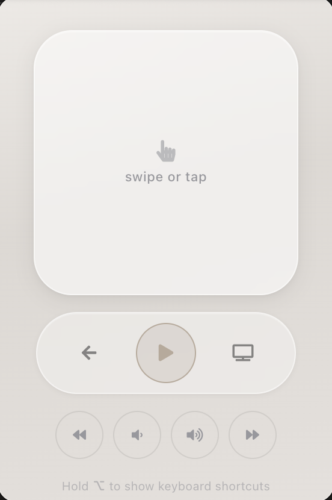
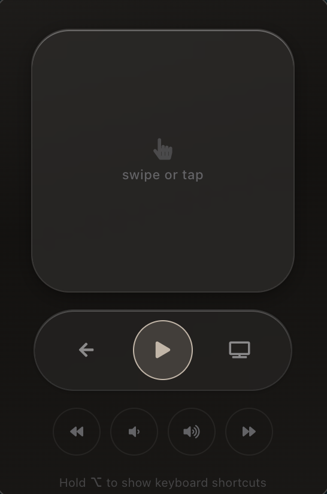

# ATV Desktop Remote

Control an Apple TV from your Mac or PC. A small menubar app built with Tauri; it talks to the Apple TV through a bundled Node backend using [node-appletv-remote](https://github.com/energee/node-appletv-remote), so there's nothing else to install.

<p align="center">
  
  
</p>

## Usage

- On first launch, pick your Apple TV and enter the PIN it shows.
- Swipe with two fingers on the touchpad to move, click to select. Use the buttons or the keyboard for the rest.
- Play/pause, the now-playing title, and a seek bar follow what's playing on the TV.
- Hold Option (Alt on Windows) to show keyboard labels. Right-click for the device menu, and open **Settings** for the theme, always-on-top, saved remotes, and the hotkey.
- The tray icon or the hotkey (`Cmd+Shift+R` on macOS, `Win+Shift+R` on Windows) shows and hides the remote. **Quit** stops it.

| Key             | Action                  |
| --------------- | ----------------------- |
| Arrow keys      | Navigate                |
| Enter           | Select                  |
| Space           | Play / pause            |
| Esc / Backspace | Menu                    |
| T / L           | Home / long-press Home  |
| G               | Top menu                |
| [ / ]           | Skip backward / forward |
| + / -           | Volume up / down        |

## Upgrading from the Electron version (0.5.x)

Saved Apple TVs don't carry over: pair again, or use **Settings → Import Credentials** with a backup. **Export Credentials** saves one for next time; treat the file as a secret. Your hotkey is kept.

## Development

Requires Node.js 24, pnpm, and Rust with the [Tauri prerequisites](https://v2.tauri.app/start/prerequisites/).

```sh
pnpm install
pnpm --dir app install --frozen-lockfile
pnpm start        # run in development
pnpm test         # vitest; also: pnpm typecheck, pnpm lint, cargo test in src-tauri
pnpm build        # bundle for this machine (pnpm build:mac for Apple silicon)
```

The webview (`src/renderer`) only displays state; the Node backend (`src/sidecar`, `src/main/atv_service.ts`) owns the Apple TV connection, and the Rust host (`src-tauri`) handles the tray, window, hotkeys, and macOS Liquid Glass. CI runs the checks on every pull request; version tags build the macOS and Windows releases.

Local macOS builds are ad-hoc signed. A notarized release needs a Developer ID identity (`bundle.macOS.signingIdentity`) and must re-sign the bundled `node` (see `scripts/build-sidecar.mjs`). The transparent glass window uses Tauri's `macOSPrivateApi`, which rules out the Mac App Store.

## License

[CC BY-NC-SA 4.0](LICENSE)
