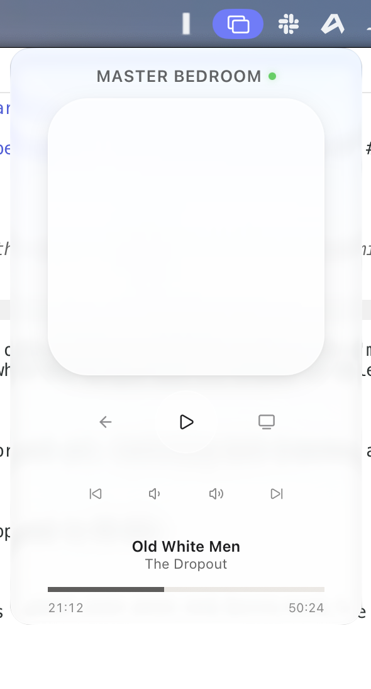

<p align="center">
  
</p>

<h1 align="center">Apple TV Remote</h1>

<p align="center">Your Apple TV, one click away in the menu bar.</p>

<p align="center">
  <a href="https://github.com/energee/appletv-desktop-remote/releases/latest"></a>
  <a href="https://github.com/energee/appletv-desktop-remote/actions/workflows/ci.yml"></a>
  
  <a href="LICENSE"></a>
</p>

<p align="center">
  <a href="https://github.com/energee/appletv-desktop-remote/releases/latest"><b>Download for macOS or Windows</b></a>
  <br/>
  <a href="https://energ.ee/appletv-desktop-remote/">Try the remote on the website</a>
</p>

<p align="center">
  
</p>

## Everything the Siri Remote does. Nothing to pick up.

- **Touchpad.** Scroll with two fingers to move around, and click to select. Press and hold for a second to long-press, which opens context menus. Same as the remote on your couch.
- **Now playing.** See what's on, then play, pause, and scrub from the seek bar.
- **Always handy.** Press `Cmd+Shift+R` (`Win+Shift+R` on Windows) to show or hide it from any app, or click the menu bar icon. Keep it on top, or let it tuck away.
- **Yours to set up.** Click the device name for the device menu, or right-click anywhere. **Settings** has the theme, always-on-top, saved remotes, and the hotkey. **Quit** stops it.

## Or just use the keyboard

Hold Option (Alt on Windows) and the remote labels every button with its key.

| Key             | Action                  |
| --------------- | ----------------------- |
| Arrow keys      | Navigate                |
| Enter           | Select                  |
| Space           | Play / pause            |
| Esc / Backspace | Menu                    |
| T / L           | Home / long-press Home  |
| G               | Top menu                |
| [ / ]           | Skip backward / forward |
| + / -           | Volume up / down        |

## Set up in a minute

1. **Download** the installer for your computer from the [latest release](https://github.com/energee/appletv-desktop-remote/releases/latest). On a Mac, open it and drag Apple TV Remote to Applications.

   | Computer           | File                        |
   | ------------------ | --------------------------- |
   | Mac, Apple silicon | `…_aarch64.dmg`             |
   | Mac, Intel         | `…_x64.dmg`                 |
   | Windows            | `…_x64-setup.exe` or `.msi` |

2. **Open it.** The app isn't notarized yet, so macOS blocks the first launch. Open System Settings, go to Privacy & Security, and click **Open Anyway**. On Windows, if SmartScreen appears, click **More info**, then **Run anyway**.
3. **Pair.** Pick your Apple TV and type the code it shows on screen. The code is sent on the fourth digit, and a wrong one brings up a new code. Your computer and Apple TV need to be on the same network.

### Upgrading from the Electron version (0.5.x)

Saved Apple TVs don't carry over: pair again, or use **Settings → Import Credentials** with a backup. **Export Credentials** saves one for next time; treat the file as a secret. Your hotkey is kept.

### Software updates

Release builds check for updates in the background after startup and once a day while running. An **Update available** button appears above the remote without opening a dialog or interrupting playback. You can also choose **Check for Updates…** from the native menu or Settings.

The update sheet shows release notes and download progress. Downloads are signature-verified; installation only starts when you choose **Install & restart**. Saved devices and settings are retained. Dismiss the sheet to keep using the remote while downloading, then return through **Update ready**. Downloads are held for the current app session; quitting before installation requires downloading again.

**Settings → Automatically check for updates** disables background checks without disabling manual checks. Development builds only check when requested. Existing versions without an updater need a one-time manual installation of an updater-enabled release.

## Free and open source

Found a problem? [Report it](https://github.com/energee/appletv-desktop-remote/issues/new). Pull requests are welcome.

Apple TV Remote is built with Tauri and talks to the Apple TV through a bundled Node backend using [node-appletv-remote](https://github.com/energee/node-appletv-remote), so there's nothing else to install. Development requires Node.js 24, pnpm, and Rust with the [Tauri prerequisites](https://v2.tauri.app/start/prerequisites/).

```sh
pnpm install
pnpm --dir app install --frozen-lockfile
pnpm start        # run in development
pnpm test         # vitest; also: pnpm typecheck, pnpm lint, cargo test in src-tauri
pnpm build        # bundle for this machine (pnpm build:mac for Apple silicon)
```

The webview (`src/renderer`) only displays state; the Node backend (`src/sidecar`) owns the Apple TV connection, and the Rust host (`src-tauri`) handles the tray, window, hotkeys, and macOS Liquid Glass. CI runs the checks on every pull request; version tags build the macOS and Windows releases. The landing page lives in `docs/` and is served by GitHub Pages.

Local macOS builds are ad-hoc signed. A notarized release needs a Developer ID identity (`bundle.macOS.signingIdentity`) and must re-sign the bundled `node` (see `scripts/build-sidecar.mjs`). The transparent glass window uses Tauri's `macOSPrivateApi`, which rules out the Mac App Store.

### Publishing signed updates

The release workflow builds macOS Apple silicon, macOS Intel, and Windows x64. Tag pushes require the GitHub Actions secret `TAURI_SIGNING_PRIVATE_KEY` (and `TAURI_SIGNING_PRIVATE_KEY_PASSWORD` if the key has a password). The matching public key is committed in `src-tauri/tauri.conf.json`; never commit the private key. Keep a secure backup of the signing key: generating a replacement key does not let already-installed apps verify it.

Keep `package.json`, `src-tauri/Cargo.toml`, and `src-tauri/tauri.conf.json` versions in sync with the `v` tag. CI creates a draft release, collects all installers, signed updater bundles, and signatures, then generates `latest.json` with release notes and the three platform download URLs. Only the complete release is published. Updater asset names are architecture-specific and GitHub-safe so uploads cannot rename them or collide.

Normal local builds and manual workflow runs do not generate updater artifacts and require no signing secret. To create signed updater artifacts locally:

```sh
export TAURI_SIGNING_PRIVATE_KEY="$HOME/.config/atv-desktop-remote/updater.key"
pnpm build --config '{"bundle":{"createUpdaterArtifacts":true}}'
```

Updater signatures authenticate the download; they are separate from Apple Developer ID signing/notarization and Windows code signing. See the [Tauri updater documentation](https://v2.tauri.app/plugin/updater/).

## License

Copyright (c) 2026 Ted Slesinski. Licensed under the [GNU General Public License, version 3 only (GPL-3.0-only)](LICENSE). Apple TV and Siri Remote are trademarks of Apple Inc. This app isn't made by or affiliated with Apple.
